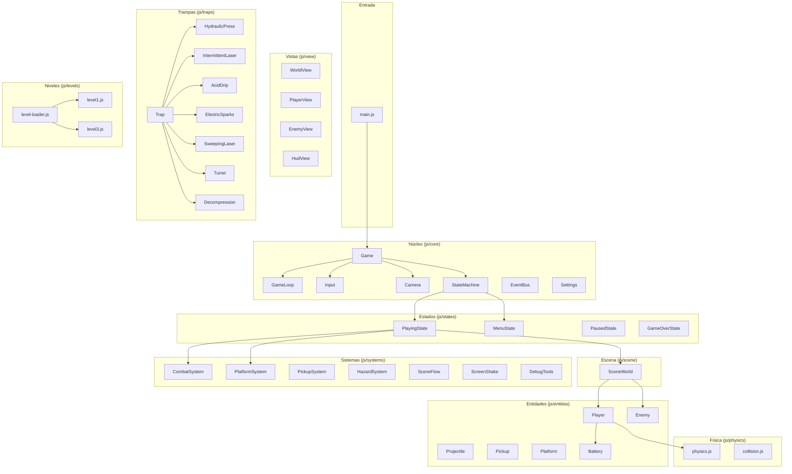

# Arquitectura del proyecto

## Principios

1. **Solo HTML, CSS y JavaScript puro** — sin frameworks, sin canvas, sin build.
2. **Separación lógica/vista** — las entidades no tocan el DOM; las vistas solo escriben variables CSS.
3. **Una responsabilidad por archivo** — cada módulo ES tiene un propósito claro.
4. **Datos = niveles** — agregar una escena no toca el motor.
5. **Sin números mágicos** — todo en `config.js`.

## Capas del sistema



## Flujo de datos

```
config.js (constantes) → entidades (lógica) → vistas (DOM)
                                ↕
                        physics.js (gravedad, colisiones)
                                ↕
                        EventBus (comunicación desacoplada)
```

## Estructura de archivos

```
index.html          Punto de entrada HTML (capas del DOM)
css/                Estilos divididos por responsabilidad
js/config.js        Todas las constantes de jugabilidad
js/main.js          Punto de entrada JS
js/core/            Motor: loop, input, cámara, estados, eventos
js/physics/         Colisiones AABB y física (gravedad, resolución)
js/entities/        Lógica de entidades (sin DOM)
js/traps/           Trampas: clase base + una por tipo + fábrica
js/scene/           Contenedor de escena (SceneWorld)
js/systems/         Reglas de juego (combate, pickups, hazards, traps, etc.)
js/states/          Estados de la máquina (playing, menu, paused, etc.)
js/ui/              Lógica de UI (HUD, tutorial, menú navigator)
js/view/            Vistas DOM (entity-view, player-view, etc.)
js/levels/          Datos de niveles (solo datos, no código)
tools/              Herramientas de desarrollo
docs/               Esta documentación
assets/             Imágenes, sprites, fuentes
```

## Herramientas compartidas para sprites

- **`findSurfaceBelow(x, fromY, solids, width)`** (`collision.js`): busca el primer sólido debajo de `fromY` alineado con la franja horizontal. Los láseres la usan para calcular la longitud del rayo cada frame.
- **`safePointExclusions`** (getter en `Trap`): por defecto devuelve `[this.zone]`. El barrido lo sobreescribe con el rayo actual ensanchado. `SafePointTracker` lo consulta cada frame.
- **Piezas repetibles** (`.trap-tile-y` / `.trap-tile-x`): regla CSS genérica que repite un sprite en un eje usando `background-repeat` con el tamaño de mosaico como variable (`--tile-w` / `--tile-h`). El largo lo da la geometría (`--w` o `--h`) de la vista.
- **`border-image`** para plataformas de ancho variable: cortes laterales definidos en `config.js` (`PLATFORMS.*.borderSlice`). Los extremos no se deforman al variar el ancho.
- **`docs/SPRITES.md`**: referencia de tamaños, frames y anclas de todos los sprites.

## Herramientas de desarrollo

- **`tools/physics-check.html`**: simula saltos a distintos FPS y verifica las restricciones de diseño, incluyendo descompresión del nivel 3.
- **`tools/level-check.html`**: detecta escalones trampa (desniveles de 1–10 px entre sólidos vecinos) y plataformas que violan la separación mínima con sólidos (`PLATFORMS.wallClearance`). Ejecutable también con `node --input-type=module -e "import './tools/level-check.js'"`.
- **`tools/trap-gallery.html`**: galería visual que muestra cada tipo de trampa congelada en cada una de sus fases, para verificar que las piezas permanentes no desaparezcan al cambiar de fase.

## Cómo agregar una trampa nueva

1. Crear `js/traps/mi-trampa.js` que extienda `Trap` (definir fases, dangerRects, zone, viewData).
2. Agregar una línea al mapa en `js/traps/trap-factory.js`: `['mi-tipo', MiTrampa]`.
3. Agregar las constantes de duración/medidas en `config.js` bajo `TRAPS.miTipo`.
4. Agregar los estilos en `css/traps.css` (sección `.trap--mi-tipo`).
5. Agregar los datos en la escena correspondiente (`traps: [{ type: 'mi-tipo', ... }]`).
6. No tocar TrapSystem, HazardSystem, SafePointTracker ni PlayingState.
