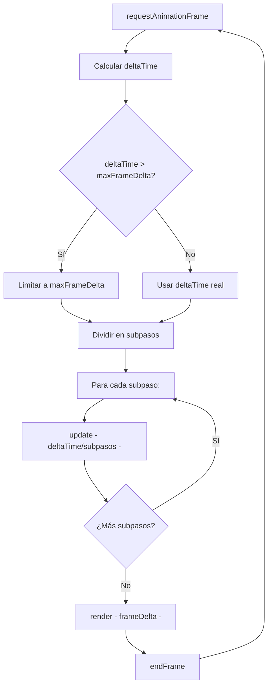

# Bucle de juego

## Visión general

El juego usa `requestAnimationFrame` (rAF) para sincronizarse con la pantalla.
Cada frame se divide en subpasos de tamaño fijo para garantizar física determinista.

## Diagrama del ciclo



## Subpasos

El frame se divide en pasos de como máximo `LOOP.maxSubstep` (1/120 s).
Con la caída máxima de 1100 px/s, el robot avanza ~9 px por paso:
no puede atravesar plataformas delgadas (20 px).

**Ejemplo**: a 30 FPS, `deltaTime ≈ 0.033 s`, se dividen en 4 subpasos de ~0.0083 s.

## Limitación de deltaTime

Si la pestaña estuvo oculta, el siguiente frame traería segundos de retraso.
`maxFrameDelta` (0.1 s) lo limita para que el robot no "teletransporte" a través del piso.

## Orden de update (PlayingState)

```
1. screenShake.update          (siempre)
2. sceneFlow.updateTransition  (si hay transición, corta)
3. ¿pause?                    (si pulsó pausa, push PausedState, corta)
4. pickupSystem.updatePanel    (si panel abierto, consume frame)
5. debugTools.handleInput      (tecla H: daño de prueba; 1–9: salto de escena)
6. ¿dying/dead/respawning?    (compuertas de estado del robot)
7. platformSystem.beforePlayer (mover plataformas + arrastrar rider)
8. player.update               (física + entrada)
9. platformSystem.afterPlayer  (detectar pisadas)
10. trapSystem.update          (avanzar trampas + escribir dynamicHazards)
11. combatSystem.update        (enemigos + proyectiles + impactos)
12. pickupSystem.update        (pickups + colisión)
13. hazardSystem.update        (peligros estáticos + dinámicos + caídas)
14. sceneFlow.checkExits       (salidas por borde/puerta)
15. tutorial.update            (carteles)
16. hud.update                 (toast timer)
17. camera.follow              (seguimiento suavizado)
```

## Separación update/render

- **update(deltaTime)**: avanza la lógica. Se llama N veces por frame (subpasos).
- **render(frameDelta)**: sincroniza el DOM con el estado. Se llama una vez por frame.
- **endFrame()**: limpia pulsaciones consumidas del input.
