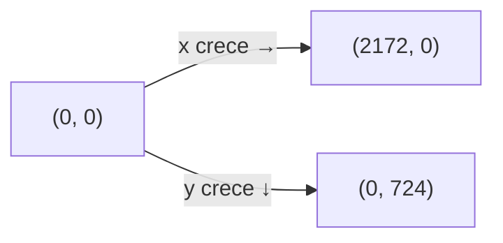

# Formato de datos de nivel

## Principio

Los niveles son solo datos. Agregar o cambiar una escena no toca el motor.
`level-loader.js` traduce las medidas de diseño a rectángulos del motor.

## Estructura de un nivel

```javascript
export const LEVEL_N = {
  id: 1,                    // número del nivel
  name: 'Nombre del nivel', // texto para el HUD
  scenes: [ /* array de escenas */ ],
};
```

## Estructura de una escena

```javascript
{
  id: 'n1e1',                    // identificador único
  name: 'Nombre de la escena',
  background: 'assets/scenes/imagen.webp',  // fondo 2172×724
  spawn: { x: 190, y: 564 },    // pies del robot (centro inferior)

  // Sólidos: plataformas y pisos (se convierten a rectángulos)
  solids: [
    { x1: 0, x2: 1000, top: 564 },           // bottom omitido = 724
    { x1: 100, x2: 300, top: 400, bottom: 450 }, // con bottom explícito
  ],

  // Zonas de daño
  hazards: [
    { x1: 1000, x2: 1228, top: 570, bottom: 590, type: 'spikes' },
  ],

  // IDs de tripulante (coleccionables que cuentan para la historia)
  crewIds: [
    { crewId: 'lucia-ferrer', x: 896, y: 400 },
  ],

  // Celdas de energía (recargan batería)
  energyCells: [
    { x: 1640, y: 350 },
  ],

  // Maniquíes de práctica (blanco de tiro)
  trainingDummies: [
    { x: 400, y: 564 },
  ],

  // Enemigos: x/y son los pies; patrol son los límites de patrulla
  enemies: [
    { x: 760, y: 378, patrol: { x1: 560, x2: 900 } },
  ],

  // Plataformas móviles: se mueven entre from y to
  movingPlatforms: [
    { from: { x: 905, y: 440 }, to: { x: 1175, y: 440 }, width: 120 },
  ],

  // Plataformas que caen al pisarlas
  fallingPlatforms: [
    { x: 985, y: 395, width: 80 },
  ],

  // Decoraciones (solo visual, sin colisión)
  decorations: [
    { type: 'pit-shadow', x1: 935, x2: 1218, top: 420 },
    { type: 'opening-door', x1: 0, x2: 80, top: 340, bottom: 498 },
    { type: 'eyes', x: 1570, y: 65 },
  ],

  // Tutorial: carteles que aparecen cerca del robot
  tutorial: [
    { id: 'move', x: 150, y: 390,
      keys: { keyboard: 'A / D', touch: '◀ ▶' },
      text: 'Moverse',
      dismiss: { event: 'player:move' } },
  ],

  // Trampas del escenario (exponen dangerRects al hazard-system)
  traps: [
    // Prensa: zona desde y=0 hasta bottom, bloque oscila entre restBottom y bottom
    { type: 'press', x1: 1480, x2: 1600, restBottom: 270, bottom: 395 },
    // Láser intermitente: x=centro, el rayo va de y=0 hasta findSurfaceBelow
    { type: 'laser', x: 1400 },
    // Goteo de ácido: x=centro, la superficie se calcula con findSurfaceBelow
    { type: 'acid-drip', x: 668 },
    // Láser de barrido: x1,x2=recorrido del riel, riel en y=0, rayo hasta findSurfaceBelow
    { type: 'sweep-laser', x1: 1510, x2: 1880 },
    // Torreta: x,y=posición, direction=1 (der) o -1 (izq)
    { type: 'turret', x: 2150, y: 300, direction: -1 },
    // Descompresión: x1,x2=zona, pullX=centro de la brecha
    { type: 'decompression', x1: 300, x2: 900, top: 0, bottom: 724, pullX: 594 },
    // phaseOffset opcional (segundos) para desfasar trampas iguales cercanas
  ],

  // Salida: por el borde derecho o por una puerta
  exit: { type: 'edge' },
  // o: exit: { type: 'door', x1: 1985, x2: 2150, top: 109, bottom: 269 },
}
```

## Coordenadas



- Origen: esquina superior izquierda de la imagen.
- Unidades: píxeles de la imagen de escena (2172 × 724).
- `top`: borde superior del sólido/hazard.
- `bottom`: borde inferior (omitido = 724, el fondo).
- `spawn.x/y`: posición de los pies del robot (centro inferior).

## Inmutabilidad

Los datos de nivel son inmutables en tiempo de ejecución. `levels.js` los congela
en profundidad con `Object.freeze` al exportarlos. Cualquier intento de mutar un
dato (agregar, cambiar o eliminar una clave) lanza `TypeError` de inmediato en
modo estricto (módulos ES), en vez de provocar errores crípticos más tarde.

Lo que una trampa u otra entidad necesite del mundo (p.ej. los sólidos para
calcular superficies) se le pasa como **argumento explícito** al construirla,
no escondido dentro del dato.

## Validación de trampas

`tools/level-check.js` valida los datos de todas las trampas de todos los niveles
contra el registro de claves válidas exportado por `trap-factory.js`. Detecta
tipos desconocidos, claves sobrantes y errores de construcción sin necesidad de
jugar hasta la escena.

## Consola del capitán y cápsula de escape

La última escena del último nivel puede incluir la secuencia de escape:

```javascript
{
  // Consola del capitán: el robot interactúa para activar la alerta
  captainConsole: { x: 1860 },

  // Cápsula de escape: aparece al activar la alerta
  escapePod: { x: 260 },
}
```

- `captainConsole.x`: centro horizontal de la consola. La superficie se calcula con `findSurfaceBelow`.
- `escapePod.x`: centro horizontal de la cápsula de escape.

## Historia entre niveles

Cada nivel puede tener un bloque `story` con título y líneas narrativas que se muestran antes de empezar:

```javascript
{
  story: {
    title: 'Nivel 1 — Carga',
    lines: [
      'Primera línea de la historia.',
      'Segunda línea.',
    ],
  },
}
```

## Cómo agregar un nivel

1. Crear `js/levels/levelN.js` con los datos de las escenas.
2. Importarlo en `js/levels/levels.js` y agregarlo al array `LEVELS`.
3. No tocar ningún otro archivo.
