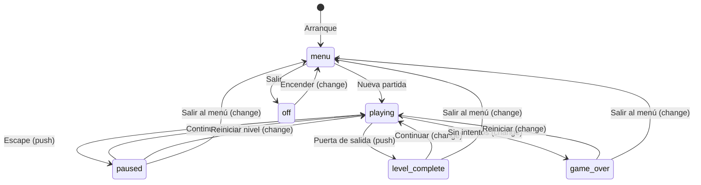
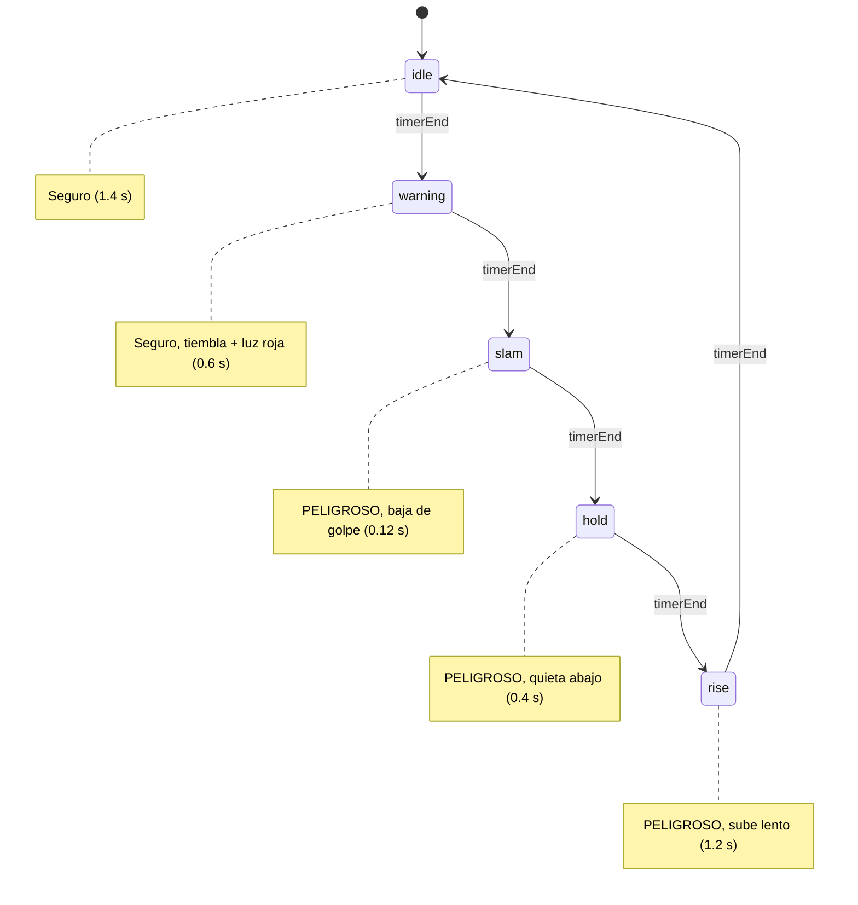
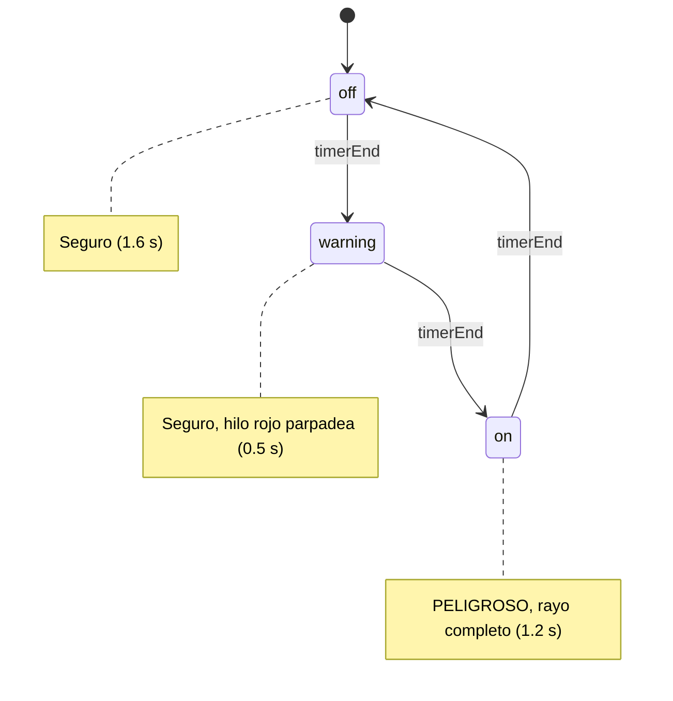

# Máquina de estados

## Concepto

El juego usa una máquina de estados con pila para gestionar las pantallas.
Cada estado tiene su propio ciclo de vida (`enter`, `exit`, `update`, `render`)
y el CSS controla la visibilidad según los atributos `data-state` y `data-overlay`.

## Diagrama de estados



## Operaciones de la pila

| Operación | Efecto | Ejemplo |
|---|---|---|
| `change(name)` | Vacía la pila, pone el nuevo estado como base | Ir al menú |
| `push(name)` | Apila sobre el estado actual (pausa el de abajo) | Abrir pausa |
| `pop()` | Quita el de arriba y reanuda el de abajo | Cerrar pausa |

## Atributos en el DOM

- `data-state`: estado base de la pila (menu, playing, game-over, off).
- `data-overlay`: estado superpuesto (paused, level-complete).
- `data-sub`: subpantalla activa (how-to-play, options, credits).
- `data-confirm`: tipo de confirmación activa (restart, exit).

El CSS usa selectores de atributo para mostrar/ocultar pantallas.
JS nunca escribe `display` directamente.

## Ciclo de vida de un estado

```
constructor(context)  → se crea una vez al arrancar el juego
enter(params)         → se activa (registra listeners, crea sistemas)
update(deltaTime)     → se llama cada frame mientras está activo
render(frameDelta)    → se llama una vez por frame para sincronizar DOM
pause()               → otro estado se apiló encima (push)
resume()              → el estado de encima se desapiló (pop)
exit()                → se desactiva (limpia listeners, destruye sistemas)
```

## Fases de la prensa hidráulica



## Fases del láser intermitente


