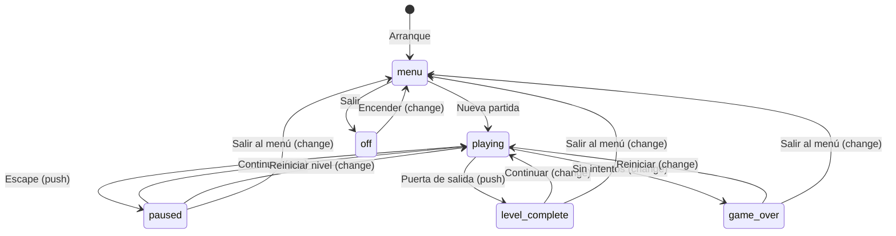
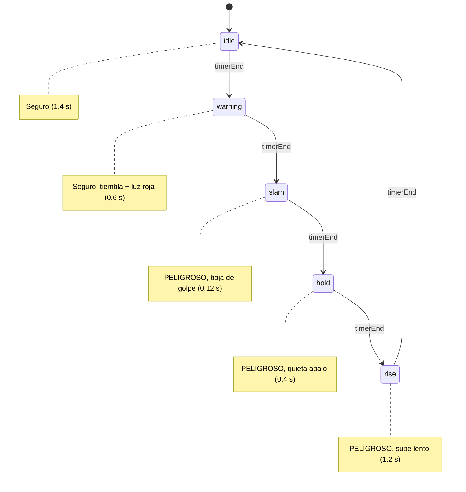
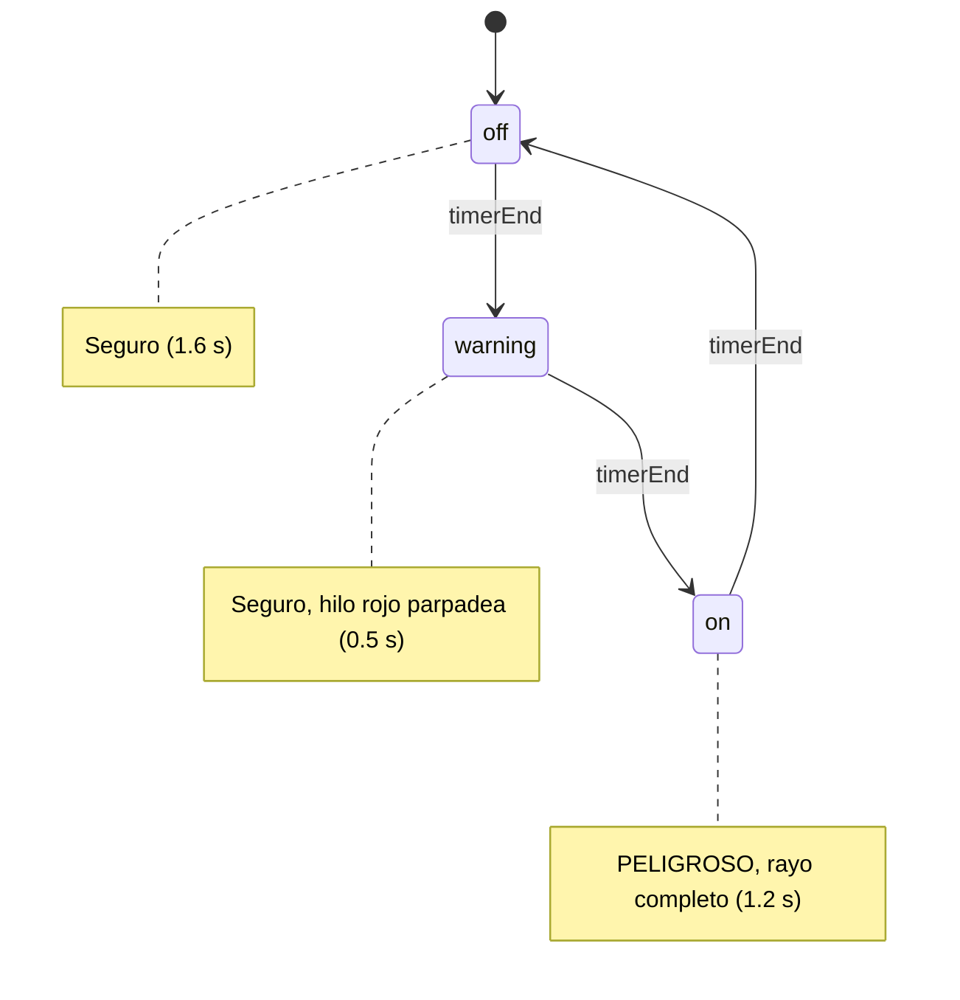
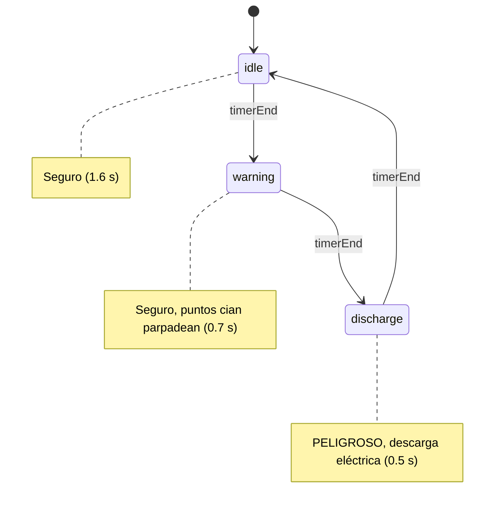
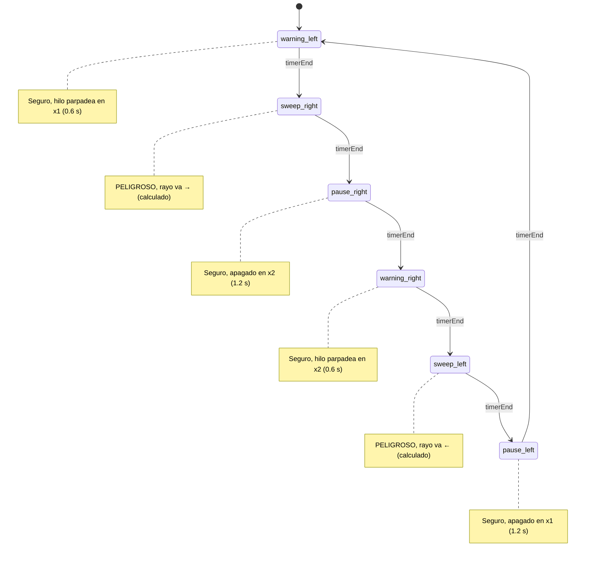

# Máquina de estados

## Concepto

El juego usa una máquina de estados con pila para gestionar las pantallas.
Cada estado tiene su propio ciclo de vida (`enter`, `exit`, `update`, `render`)
y el CSS controla la visibilidad según los atributos `data-state` y `data-overlay`.

## Diagrama de estados



## Operaciones de la pila

| Operación | Efecto | Ejemplo |
|---|---|---|
| `change(name)` | Vacía la pila, pone el nuevo estado como base | Ir al menú |
| `push(name)` | Apila sobre el estado actual (pausa el de abajo) | Abrir pausa |
| `pop()` | Quita el de arriba y reanuda el de abajo | Cerrar pausa |

## Atributos en el DOM

- `data-state`: estado base de la pila (menu, playing, game-over, off).
- `data-overlay`: estado superpuesto (paused, level-complete).
- `data-sub`: subpantalla activa (how-to-play, options, credits).
- `data-confirm`: tipo de confirmación activa (restart, exit).

El CSS usa selectores de atributo para mostrar/ocultar pantallas.
JS nunca escribe `display` directamente.

## Ciclo de vida de un estado

```
constructor(context)  → se crea una vez al arrancar el juego
enter(params)         → se activa (registra listeners, crea sistemas)
update(deltaTime)     → se llama cada frame mientras está activo
render(frameDelta)    → se llama una vez por frame para sincronizar DOM
pause()               → otro estado se apiló encima (push)
resume()              → el estado de encima se desapiló (pop)
exit()                → se desactiva (limpia listeners, destruye sistemas)
```

## Sprites por fase

Cada trampa muestra un frame de su hoja según la fase actual:

| Trampa | idle | warning | on/slam/discharge | hold | Otros |
|---|---|---|---|---|---|
| Prensa (bloque) | frame 1 | frame 1 + tiembla | frame 1 | frame 2 (golpe) | — |
| Láser (emisor) | frame 1 | frame 1 | frame 2 | — | — |
| Láser (rayo) | oculto | frame 1 (hilo) | frame 2 | — | — |
| Chispas | frame 1 | frame 2 (parpadeo) | frames 3↔4 (steps) | — | — |
| Torreta | frame 1 | — | — | — | frame 2 (destruida) |
| Tubería ácido | frame 1 | frame 2 | — | — | — |

Los láseres (intermitente y barrido) calculan la longitud del rayo en cada paso con `findSurfaceBelow`, ajustándose dinámicamente a sólidos y plataformas.

## Fases de la prensa hidráulica



## Fases del láser intermitente



## Fases de las chispas eléctricas



## Fases del láser de barrido



## Fases de la torreta

```mermaid
stateDiagram-v2
    [*] --> idle
    idle --> aiming: timerEnd
    aiming --> fire: timerEnd
    fire --> cooldown: timerEnd
    cooldown --> idle: timerEnd

    note right of idle: Inactiva (1.0 s)
    note right of aiming: Luz roja parpadea (0.9 s)
    note right of fire: Emite turret:fire (0.1 s)
    note right of cooldown: Enfriamiento (0.8 s)
```

Cuando la torreta recibe suficientes impactos (health = 2), queda destruida: sin fases, sin peligro, sin ser disparable.

## Descompresión

La descompresión no tiene fases cíclicas: siempre está activa. Expone `pullFor(body)` que devuelve la velocidad externa hacia `pullX`. `dangerRects` es siempre vacío; su `zone` cuenta para el punto seguro.
