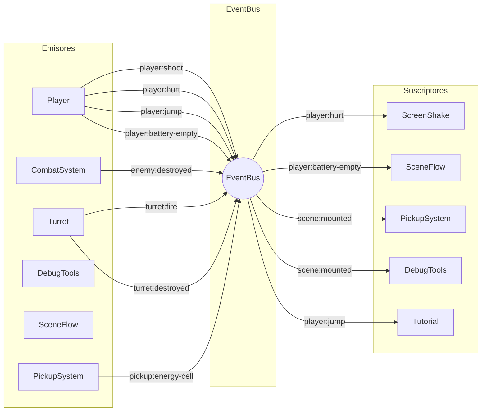

# Sistema de eventos

## Concepto

EventBus implementa el patrón pub/sub para comunicación desacoplada entre sistemas.
Los sistemas nunca se llaman entre sí — emiten eventos que otros escuchan.

## Diagrama de flujo



## Lista de eventos

| Evento | Payload | Emisor | Suscriptores |
|---|---|---|---|
| `player:move` | — | Player | Tutorial |
| `player:jump` | — | Player | Tutorial |
| `player:double-jump` | — | Player | Tutorial |
| `player:shoot` | `{x, y, direction}` | Player | CombatSystem |
| `player:hurt` | `{intensity}` | Player | ScreenShake |
| `player:battery-empty` | — | Player | SceneFlow |
| `player:respawn-end` | — | Player | SceneFlow |
| `player:hazard` | — | HazardSystem | — |
| `pickup:energy-cell` | — | PickupSystem | Tutorial |
| `pickup:crew-id` | `{crewId}` | PickupSystem | — |
| `enemy:destroyed` | — | CombatSystem | CombatSystem (puntos) |
| `turret:fire` | `{x, y, direction}` | Turret | CombatSystem |
| `turret:destroyed` | `{x, y}` | Turret | CombatSystem (puntos) |
| `scene:mounted` | — | PlayingState | PickupSystem, DebugTools |
| `debug:jump-scene` | `{index}` | DebugTools | SceneFlow |
| `session:score` | `{score}` | GameSession | — |
| `session:life-lost` | `{lives}` | GameSession | — |

## API del EventBus

```javascript
const unsub = events.on('player:hurt', (data) => { ... });
events.emit('player:hurt', { intensity: 15 });
unsub();                // cancela la suscripción
events.clear();         // limpia todo (solo en destroy)
events.listenerCount;   // para detectar fugas en depuración
```
