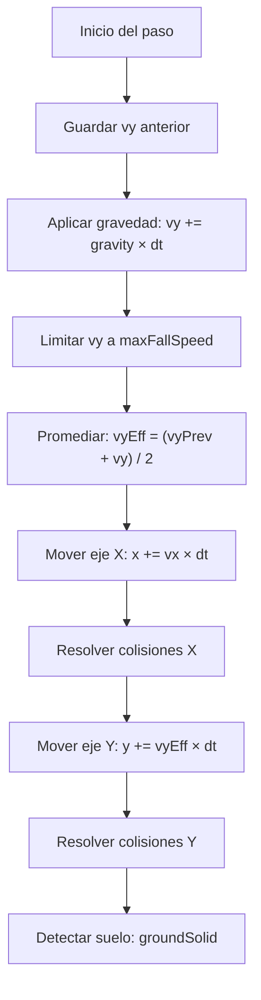

# Sistema de física

## Visión general

Física 2D con gravedad, colisiones AABB (Axis-Aligned Bounding Box) y resolución
por eje separado. Determinista a cualquier tasa de frames gracias a los subpasos.

## Gravedad y movimiento



### Promedio de velocidad vertical

Se usa el promedio entre la velocidad anterior y la nueva (`vyEff = (vyPrev + vy) / 2`)
en vez de solo la velocidad nueva. Esto es una integración semi-implícita de Euler
que mejora la precisión del salto y reduce la dependencia del framerate.

## Colisiones AABB

```
rectsOverlap(a, b):  a.x < b.x + b.width  &&
                     a.x + a.width > b.x   &&
                     a.y < b.y + b.height  &&
                     a.y + a.height > b.y
```

Es la ÚNICA prueba de colisión del juego. Todas las entidades usan rectángulos.

### Resolución por eje

Se mueve primero en X, se resuelven las colisiones en X, luego se mueve en Y y se
resuelven en Y. Esto evita el "problema de la esquina" donde mover en ambos ejes
a la vez puede empujar al cuerpo en la dirección incorrecta.

## Mecánicas de salto

### Salto simple
- Altura: 100 px (configurable en `PLAYER.jumpHeight`).
- Velocidad inicial calculada con `velocityForHeight(h) = -√(2 × gravity × h)`.
- Alcance horizontal: ~114 px.

### Doble salto
- Altura adicional: 55 px (`PLAYER.doubleJumpHeight`).
- Usa los mismos frames de animación que el salto normal.
- Al caer de un borde sin saltar y luego saltar en el aire, se consume el doble salto.

### Coyote time
- 0.06 s después de salir del borde, el robot aún puede saltar.
- Evita que el jugador sienta que le "robaron" un salto.

### Jump buffer
- Si el jugador pulsa saltar hasta 0.1 s antes de tocar el piso, el salto se ejecuta.
- Compensa la latencia de reacción del jugador.

## Restricciones verificadas

| Medida | Valor | Requisito |
|---|---|---|
| Salto simple | 114 px horiz., 100 alto | escalones de hasta 76 px |
| Doble salto (con coyote) | 202 (217) | pinchos N1E1 ≥ 180, ácido N2E1 ≥ 185 |
| Foso N1E3 | — | < 242 (imposible, requiere plataforma) |

Estas restricciones se verifican con `tools/physics-check.html`.
