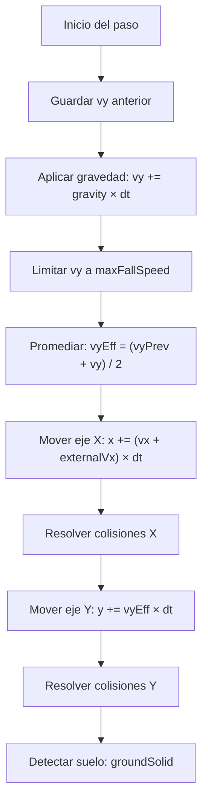

# Sistema de física

## Visión general

Física 2D con gravedad, colisiones AABB (Axis-Aligned Bounding Box) y resolución
por eje separado. Determinista a cualquier tasa de frames gracias a los subpasos.

## Gravedad y movimiento



### Promedio de velocidad vertical

Se usa el promedio entre la velocidad anterior y la nueva (`vyEff = (vyPrev + vy) / 2`)
en vez de solo la velocidad nueva. Esto es una integración semi-implícita de Euler
que mejora la precisión del salto y reduce la dependencia del framerate.

## Colisiones AABB

```
rectsOverlap(a, b):  a.x < b.x + b.width  &&
                     a.x + a.width > b.x   &&
                     a.y < b.y + b.height  &&
                     a.y + a.height > b.y
```

Es la ÚNICA prueba de colisión del juego. Todas las entidades usan rectángulos.

### Resolución por eje

Se mueve primero en X, se resuelven las colisiones en X, luego se mueve en Y y se
resuelven en Y. Esto evita el "problema de la esquina" donde mover en ambos ejes
a la vez puede empujar al cuerpo en la dirección incorrecta.

## Mecánicas de salto

### Salto simple
- Altura: 100 px (configurable en `PLAYER.jumpHeight`).
- Velocidad inicial calculada con `velocityForHeight(h) = -√(2 × gravity × h)`.
- Alcance horizontal: ~114 px.

### Doble salto
- Altura adicional: 55 px (`PLAYER.doubleJumpHeight`).
- Usa los mismos frames de animación que el salto normal.
- Al caer de un borde sin saltar y luego saltar en el aire, se consume el doble salto.

### Coyote time
- 0.06 s después de salir del borde, el robot aún puede saltar.
- Evita que el jugador sienta que le "robaron" un salto.

### Jump buffer
- Si el jugador pulsa saltar hasta 0.1 s antes de tocar el piso, el salto se ejecuta.
- Compensa la latencia de reacción del jugador.

## Restricciones verificadas

| Medida | Valor | Requisito |
|---|---|---|
| Salto simple | 114 px horiz., 100 alto | escalones de hasta 76 px |
| Doble salto (con coyote) | 202 (217) | pinchos N1E1 ≥ 180, ácido N2E1 ≥ 185 |
| Foso N1E3 | — | < 242 (imposible, requiere plataforma) |

Estas restricciones se verifican con `tools/physics-check.html`.

## Fuerza externa (externalVx)

`body.externalVx` es una velocidad horizontal (px/s) que se suma al desplazamiento
en `stepBody` sin tocar `vx`. Se usa para la trampa de descompresión del nivel 3.

### Por qué es una velocidad separada

Si se sumara directamente a `vx`, la aceleración/frenado del robot (approach hacia
`runSpeed`) compensaría la fuerza inmediatamente. Al ser una velocidad externa:
- El desplazamiento total es `(vx + externalVx) × dt`.
- El robot controla su `vx` normalmente (corre, frena, salta).
- La fuerza actúa como un "viento" constante que se suma al movimiento propio.
- Con `externalVx = 0` el resultado es idéntico al motor original.

### Verificación con descompresión

Con strength = 80 px/s (menor que runSpeed = 245):
- El robot puede caminar en contra de la corriente (245 - 80 = 165 px/s neto).
- Si se queda quieto, la corriente lo arrastra a 80 px/s.
- Los saltos con fuerza a favor ganan ~40 px de alcance horizontal.
- Los saltos con fuerza en contra pierden ~40 px de alcance horizontal.

### Plataformas que caen en N3

Una sola plataforma por brecha, centrada en `pullX`, ancho 100 px.

| Brecha | Distancia | Plataforma | Entrada (simple+help) | Salida (doble+against+coyote) | Sin plataforma |
|---|---|---|---|---|---|
| N3E1 (383→805) | 422 px | 544–644 | 154 ≥ 113 (margen 41) ✅ | 152 ≥ 113 (margen 39) ✅ | 286 < 374 (margen 88) ✅ |
| N3E3 (331→643) | 312 px | 437–537 | 154 ≥ 58 (margen 96) ✅ | 152 ≥ 58 (margen 94) ✅ | 219 < 264 (margen 45) ✅ |

### Grosor de colisión de plataformas

El robot recorre como máximo `maxFallSpeed × maxSubstep = 1100 × (1/120) ≈ 9.17 px` por subpaso.
El grosor debe ser mayor que ese valor para que la colisión siempre se detecte:

| Tipo | Alto (px) | Margen |
|---|---|---|
| Móvil | 17.5 | 8.33 px ✅ |
| Que cae | 11 | 1.83 px ✅ |

## Búsqueda de superficie: findSurfaceBelow

`findSurfaceBelow(x, fromY, solids, width)` busca el primer sólido cuyo borde superior está por debajo de `fromY` y que se superpone horizontalmente con la franja `[x − width/2, x + width/2]`. Devuelve el `y` del sólido encontrado, o el alto de la escena si no hay ninguno. Se usa para los láseres dinámicos.
